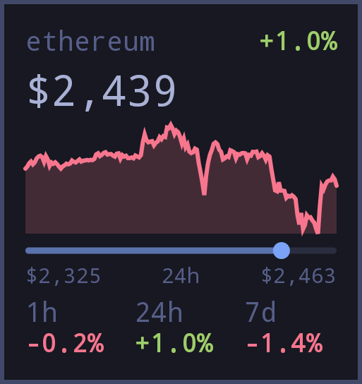

# Ethereum ticker

Ethereum (ETH) prices in USD from CoinGecko, refreshed every five minutes while the widget is active. The tile shows the price, 1-hour/24-hour/7-day changes, a seven-day chart and the daily range. Tap for market cap, volume, all-time high, rank and supply details.

Uses Android HTTP directly; no Linux packages, API key or setup required. Preferred size: 3×3 cells; minimum: 3×2. Requires OWL 5.

## Credits and license

Adapted by [rabfulton](https://github.com/rabfulton) from [Simon Schubert's Bitcoin widget](https://github.com/SimonSchubert/omarchy-widgets/tree/main/widgets/simonschubert/crypto). The original layout, chart, formatting and market view are retained. This adaptation selects Ethereum and replaces Bitcoin's mining progress with circulating and total ETH supply and a nullable maximum supply.

Market data: [CoinGecko](https://www.coingecko.com/en/coins/ethereum).

MIT License

Copyright (c) 2026 Simon Schubert and contributors

Permission is hereby granted, free of charge, to any person obtaining a copy
of this software and associated documentation files (the "Software"), to deal
in the Software without restriction, including without limitation the rights
to use, copy, modify, merge, publish, distribute, sublicense, and/or sell
copies of the Software, and to permit persons to whom the Software is
furnished to do so, subject to the following conditions:

The above copyright notice and this permission notice shall be included in all
copies or substantial portions of the Software.

THE SOFTWARE IS PROVIDED "AS IS", WITHOUT WARRANTY OF ANY KIND, EXPRESS OR
IMPLIED, INCLUDING BUT NOT LIMITED TO THE WARRANTIES OF MERCHANTABILITY,
FITNESS FOR A PARTICULAR PURPOSE AND NONINFRINGEMENT. IN NO EVENT SHALL THE
AUTHORS OR COPYRIGHT HOLDERS BE LIABLE FOR ANY CLAIM, DAMAGES OR OTHER
LIABILITY, WHETHER IN AN ACTION OF CONTRACT, TORT OR OTHERWISE, ARISING FROM,
OUT OF OR IN CONNECTION WITH THE SOFTWARE OR THE USE OR OTHER DEALINGS IN THE
SOFTWARE.
