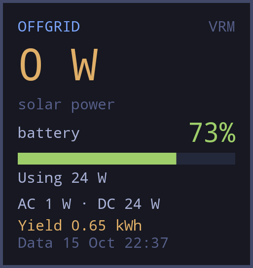

# Offgrid solar for Victron VRM

A self-contained OWL widget for solar power, battery state of charge, battery power, AC output, DC loads and solar yield. Requires OWL 5 or later. Uses Android HTTP directly; no Linux installation, packages or helper scripts are needed.

## Install and connect

Install through the widget store when available, import a shared widget link, or copy widget.owl into ~/.config/omalauncher/widgets/ under a unique .owl filename.

1. In VRM, select **Preferences → Integrations**, then click **Add** to create an API access token.
2. Follow the VRM prompts to create the token and copy its value. The account/token must have access to the installation you want to monitor.
3. Open that installation in VRM. Copy the numeric ID from its dashboard URL (the number after `/installation/`).
4. In the widget, tap **set up**, enter the installation ID and paste the token, then tap **connect**. The dashboard reports whether the connection succeeds.

The setup screen also includes a **get a VRM token** button linking to https://vrm.victronenergy.com/access-tokens.

Tap the tile for details. **connection settings** lets you replace the connection or clear its saved details. When replacing credentials, enter a token again; the existing token is not displayed.

Settings persist locally in launcher state, separately from the source. The token is plain text on the local device and is visible while entering it. Share only widget.owl (or its launcher share link), not launcher state or device backups. New installations start with blank settings.

## Readings

Checks VRM once per minute while the widget is active. Measurements follow your GX upload interval; readings over 30 minutes old are flagged. Missing measurements appear as an ellipsis. Battery power is positive when charging and negative when discharging.

Solar power uses the DC-coupled system value, falling back to solar charger PV values. Yield totals the connected solar chargers. AC output totals available phases. Charger peaks is the sum of individual charger daily peaks, not necessarily the simultaneous system peak. AC-coupled solar generation is not included. Daily figures refer to the device's reported day. The timestamp follows the battery SOC record.

## Sharing and publishing

This folder contains no personal installation ID or token. For the widget store, submit widget.owl, preview.png and this README under widgets/<github-username>/victron/. The widget declares MIT licensing and store metadata.

For a local-only install, removing a widget moves it to the launcher's .removed folder; move it back to restore it.

## Screenshot

