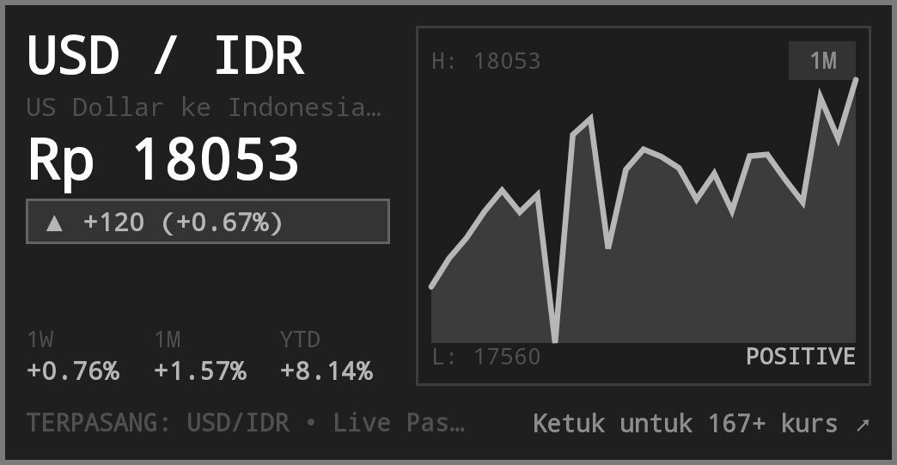

# 💱 Currency & Forex Rates Widget for Omalauncher

Widget pemantau kurs mata uang valas (*foreign exchange & currency rates tracker*) lengkap dan interaktif untuk [Omalauncher](https://github.com/SimonSchubert/omarchy-widgets) Android. Menampilkan kurs pasar langsung (*live exchange rates*), grafik sparkline historis transparan yang adaptif mengikuti tema Omarchy, serta katalog interaktif 167+ pasangan mata uang dunia.



---

## 🌟 Fitur Unggulan

### 1. 📱 Home-Screen Tile (Ukuran 6x3)
- **Tampilan Utama Bersih & Elegan**:
  - Menampilkan pasangan kurs terpasang (default: **`USD / IDR`**), nama mata uang lengkap, harga kurs terkini, dan badge persentase perubahan 24 jam.
  - **Grafik Sparkline Transparan**: Menggambar grafik riwayat kurs (*time-series*) langsung menggunakan Canvas/Sparkline bawaan launcher yang menyatu dengan latar belakang tema aktif Omarchy (tanpa gambar eksternal / tanpa *hardcoded colors*).
  - **Metrik Kinerja Cepat**: Tiga ringkasan persentase performa pasar (**1W**, **1M**, dan **YTD**).
  - **Bebas Ketukan Liar (*Accidental Tap-Safe*)**: Area bawah widget menampilkan bar informasi terpasang (`TERPASANG: USD/IDR • Live Pasar`), dan mengetuk area mana pun pada tile akan membuka layar detail modal tanpa risiko salah pencet.

### 2. 📑 Layar Detail Modal Lengkap (`screen { }`)
Cukup ketuk widget di home-screen untuk membuka manajer valas layar penuh:

- **Kartu Kurs Utama Interaktif**:
  - **⭐ Pasang ke Layar Utama**: Pasang pasangan mata uang yang sedang dilihat ke home-screen tile dengan tombol `[ ⭐ Pasang ]`, atau lihat status `[ ✓ Terpasang ]` jika sudah aktif.
  - **⇄ Balik Pasangan Kurs (*Instant Inversion*)**: Balik pasangan mata uang dasar dan pembanding secara instan (contoh: **`USD / IDR`** ⇄ **`IDR / USD`**). Dilengkapi format presisi angka mikro-desimal (hingga 6–8 digit desimal) untuk kurs bernilai kecil.
  - **Pilihan Rentang Waktu Grafik**: Pilih rentang waktu riwayat grafik antara `1W`, `1M`, `3M`, `6M`, `1Y`, hingga `5Y` dengan pembacaan batas harga tertinggi (*High*) dan terendah (*Low*).
  - **Statistik Lengkap**: 1 Minggu (Weekly), 1 Bulan (Monthly), Tahun Ini (YTD), dan Tren Pasar (**NAIK**, **TURUN**, atau **NETRAL**).
  - **Chip Pasangan Populer**: Akses 1-ketukan untuk pasangan terpopuler: `USD/IDR`, `EUR/USD`, `USD/JPY`, `GBP/IDR`, `SGD/IDR`, dan `EUR/IDR`.

- **Katalog & Filter 167+ Pasangan Mata Uang Dunia**:
  - **Pencarian Instan**: Cari berdasarkan kode simbol (misal `EUR`, `JPY`, `USD`) maupun nama negara/mata uang.
  - **Filter Mata Uang Tujuan (Quote)**: Filter cepat dengan tab `ALL`, `IDR`, `USD`, `EUR`, `GBP`, `JPY`, dan `SGD`.
  - **Pengurutan Data (Sorting)**: Urutkan data berdasarkan `% Berubah`, `Harga`, `1 Minggu`, atau `Simbol` dengan urutan `DESC` atau `ASC`.
  - **Filter Arah Tren**: Saring pasar berdasarkan tren `Semua`, `Hanya Naik (▲)`, `Hanya Turun (▼)`, atau `Netral (•)`.
  - **Paginasi & Limit Fleksibel**: Pilihan tampilan data 10, 20, atau 50 baris per halaman dengan kontrol navigasi `‹ Prev` dan `Next ›`.
  - **Indikator Visual Jelas**: Setiap baris tabel ditandai badge hijau `⭐ TERPASANG` untuk kurs yang aktif di home screen dan aksen `DILIHAT` untuk kurs yang sedang diinspeksi.

---

## 📱 Tampilan Layar Penuh


---

## 🚀 Panduan Pemasangan

### 1. Prasyarat Paket
Widget ini membutuhkan paket `curl` dan `jq` untuk memproses data feed kurs dan grafik. Pasang melalui pacman di terminal:
```bash
pacman -S --needed curl jq
```

### 2. Salin File ke Direktori Widgets Omalauncher
Salin file `widget.owl` ke folder widget Omalauncher Anda:
```bash
cp widget.owl ~/.config/omalauncher/widgets/15-currency.owl
```

### 3. Cek & Verifikasi
Jalankan `owl-check` untuk memverifikasi widget:
```bash
owl-check ~/.config/omalauncher/widgets/15-currency.owl
```

Widget akan langsung muncul di home screen ponsel Anda!

---

## 🛠️ Persyaratan Sistem

- **Omalauncher**: OWL 8
- **Paket Pacman**: `curl`, `jq` (otomatis diminta via deklarasi `requires`)

---

## 👨‍💻 Pembuat & Lisensi

Dibuat dengan ❤️ oleh [zyanmd](https://github.com/zyanmd).

Didistribusikan di bawah lisensi [MIT](LICENSE).

---

## 💖 Ucapan Terima Kasih & Kredit

- **[Simon Schubert](https://github.com/SimonSchubert)** atas pembuatan launcher & ekosistem [Omalauncher / Omarchy](https://github.com/SimonSchubert/omarchy-widgets).
- Data nilai tukar pasar disediakan oleh European Central Bank via Frankfurter API & Yahoo Finance.
