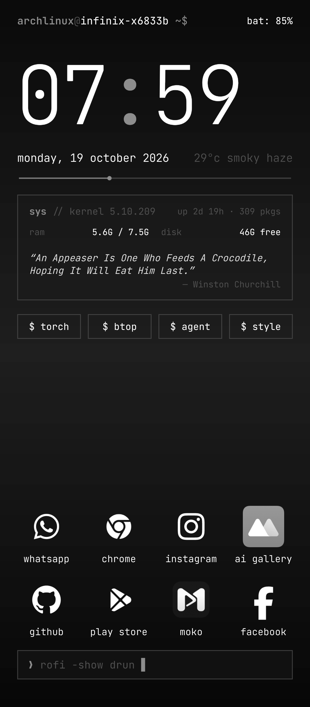

# Nexus Face for Omalauncher

An elegant, minimalist Arch Linux-inspired home screen face for [Omalauncher](https://github.com/SimonSchubert/omarchy-widgets).

## Features

- **JetBrains Mono Typography**: Crisp, clean developer aesthetic with precision font weights.
- **Hero Clock & Day Progress Hairline**: Large clock paired with a 1px timeline showing elapsed day from midnight to midnight.
- **System Vitals**: Kernel version, uptime, pacman package count, and RAM & disk gauges with progress bars.
- **Live Online Quotes**: Real-time quotes fetched directly from the web with tap-to-refresh and haptic feedback.
- **Quick Command Chips**: Quick-access actions for torch toggle, btop monitor, AI agent, and launcher theme styling.
- **Clean App Launcher & Rofi Prompt**: Spacious 4x2 favorite apps grid with interactive terminal search bar (`rofi -show drun`).
- **Dynamic Theme Adaptation**: Automatically harmonizes with any Omarchy theme (`accent`, `surface`, `border`, `background`).
- **Emoji-Free**: Pure Unix / Arch Linux styling with clean monospace text and symbols.

## Requirements

- Omalauncher with OWL 10 support.
- Arch Linux subsystem for package counters and btop monitor.
