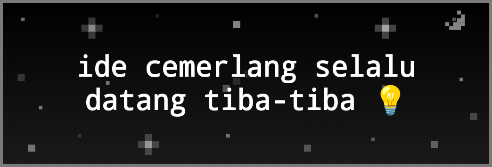

# ✨ Pixel Thoughts Widget for Omalauncher

Widget catatan pikiran spontan memanjang (*elongated scratchpad & thought banner*) untuk [Omalauncher](https://github.com/SimonSchubert/omarchy-widgets) Android. Menampilkan catatan pikiran mengambang secara minimalis di atas latar belakang langit pixel animasi retro yang dinamis beradaptasi dengan tema Omarchy Anda.



---

## 🌟 Fitur Unggulan

- **🧘 Desain Bersih & Minimalis**:
  - Home-screen tile menampilkan teks pikiran dan latar belakang animasi pixel adaptif.
  - Ukuran banner memanjang `6x2` (responsif hingga `6x3` atau `4x2`).
  - **Rotasi Pikiran Fleksibel**: Otomatis berganti secara mulus jika terdapat lebih dari satu catatan, tanpa tombol di tile.
  - **Pemilihan Font Pixel**: Pilihan gaya tulisan retro sesuai selera (*Monospace*, *Sans Pixel*, atau *Serif Retro*).
  - **Kecepatan Pergantian Teks**: Pilihan interval pergantian teks (`5s`, `8s`, `12s`, `20s`, `30s`) di layar penuh.

- **🎨 4 Suasana Langit Pixel Adaptif Tema**:
  Latar belakang dan palet warna kanvas otomatis berganti mengikuti tema aktif Omalauncher tanpa warna paten (*zero hardcoded colors*):
  - **✨ Langit Malam (*Night*)**: Untuk tema gelap/hitam/navy (`vantablack`, `tokyo-night`, `solitude`, `catppuccin`, dll.). Dihiasi bintang pixel berkelap-kelip, kilau bintang silang 4-titik, bintang jatuh (*meteor*), dan bulan sabit pixel.
  - **☁️ Langit Siang (*Daytime*)**: Untuk tema putih/terang (`white`, `catppuccin-latte`, `flexoki-light`, dll.). Dihiasi awan pixel melayang bergaris tepi retro, matahari pixel bersinar, dan burung-burung pixel di langit cerah.
  - **🌅 Langit Senja (*Sunset*)**: Untuk tema bernuansa oranye/hangat (`retro-82`, `ristretto`, `matte-black`, `last-horizon`, dll.). Menampilkan matahari terbenam keemasan di cakrawala, awan senja bernuansa jingga, dan Bintang Kejora pertama.
  - **🌌 Langit Aurora (*Mystic*)**: Untuk tema hijau/alam (`everforest`, `osaka-jade`, `kanagawa`, `miasma`, dll.). Menampilkan gelombang cahaya Aurora Borealis zamrud yang berombak hidup di antara bintang-bintang.

- **📑 Layar Penuh Catatan (`screen { }`)**:
  - Cukup ketuk widget di home-screen untuk membuka manajer catatan layar penuh.
  - Input cepat untuk menulis pikiran baru.
  - Pencarian / filter catatan secara instan.
  - Tombol aksi: **Salin ke clipboard**, **Bagikan (*share sheet*)**, dan **Hapus catatan**.

- **💾 Penyimpanan & Persistensi Cepat**:
  - Disimpan secara lokal di `~/.local/share/pixel-thoughts/notes.json` menggunakan format JSON terstruktur.
  - Pembaruan file otomatis dan instan tanpa perlu polling berat.

---

## 📱 Tampilan Layar Penuh


---

## 🚀 Panduan Pemasangan

### 1. Prasyarat Paket
Widget ini membutuhkan paket `jq` untuk memproses data catatan JSON. Pasang dengan pacman:
```bash
pacman -S --needed jq
```

### 2. Salin File ke Direktori Widgets Omalauncher
Salin file `widget.owl` ke folder widget Omalauncher Anda:
```bash
cp widget.owl ~/.config/omalauncher/widgets/pixel-thoughts.owl
```

### 3. Cek & Verifikasi
Jalankan `owl-check` untuk memverifikasi widget:
```bash
owl-check ~/.config/omalauncher/widgets/pixel-thoughts.owl
```

Widget akan langsung muncul di home screen ponsel Anda dalam hitungan detik!

---

## 🛠️ Persyaratan Sistem

- **Omalauncher**: OWL 8
- **Paket Pacman**: `jq` (otomatis diminta via deklarasi `requires`)

---

## 👨‍💻 Pembuat & Lisensi

Dibuat dengan ❤️ oleh [zyanmd](https://github.com/zyanmd).

Didistribusikan di bawah lisensi [MIT](LICENSE).

---

## 💖 Ucapan Terima Kasih & Kredit

- **[Simon Schubert](https://github.com/SimonSchubert)** atas pembuatan launcher & ekosistem [Omalauncher / Omarchy](https://github.com/SimonSchubert/omarchy-widgets).
- Terinspirasi dari konsep meditasi dan visualisasi pikiran mengambang [Pixel Thoughts](https://www.pixelthoughts.co/).
- Komunitas dan pembuat tema-tema indah di Omalauncher.

